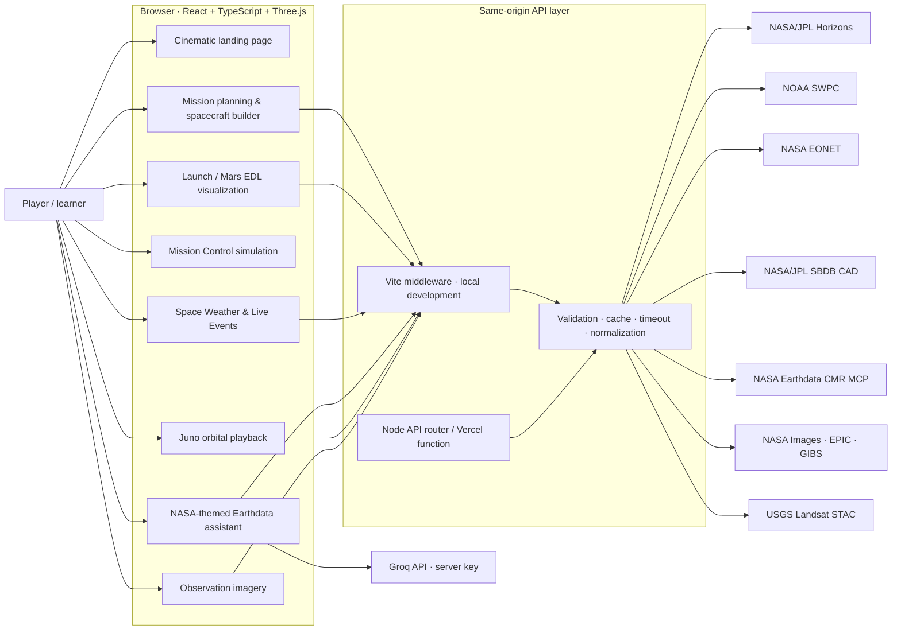
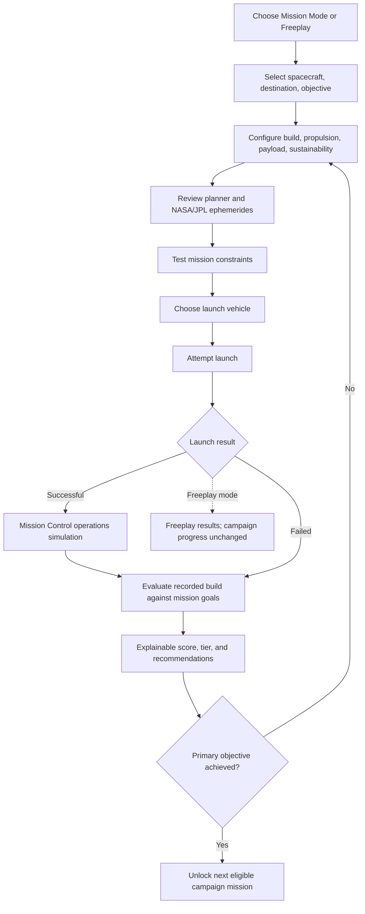
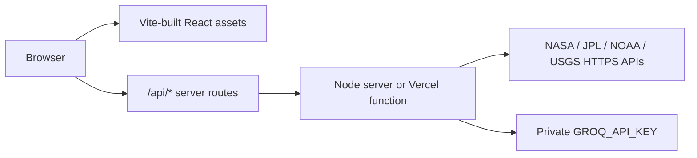

# Amplify Vision

**A NASA-resource-informed space mission engineering and exploration simulator.**

[Open the live application](https://amplify-vision.vercel.app/) · [NASA model provenance](./MODEL_SOURCES.md) · [NASA mission and API references](#references)

Amplify Vision brings mission planning, spacecraft configuration, launch visualization, NASA and NOAA live-data experiences, a deterministic mission-operations simulator, and Juno's Jupiter-centered ephemeris visualization into one browser application. It combines locally bundled NASA 3D assets and imagery with live public agency APIs, while clearly distinguishing educational models from real spacecraft telemetry and engineering design.

> **Important scope note:** Amplify Vision is an educational game and visualization. It is not an official NASA service, is not endorsed by NASA, and is not a flight-planning or spacecraft operations tool. Some interfaces use live NASA/JPL/NOAA/USGS data; many engineering values and mission outcomes are deliberate gameplay abstractions. A live ephemeris is not live spacecraft telemetry.

### Technology at a glance

- **Client:** React 19, TypeScript, Vite, Tailwind CSS, Framer Motion, and React Three Fiber.
- **3D:** Three.js, Drei, GLTF/GLB loading with the locally bundled Draco decoder, STL loading, instanced procedural terrain/rocks, and a Three.js geometry worker for model handling.
- **Server/API:** Node.js route handlers shared by Vite development middleware, the standalone Node application, and the Vercel function entry point.
- **Validation:** Vitest tests for application logic and provider payloads; Oxlint for static checks.
- **Persistence:** Browser local storage for campaign progress, mission operations sessions, selected event records, and cached planetary vectors.

## Contents

- [A visual tour](#a-visual-tour)
- [What you can do](#what-you-can-do)
- [NASA, JPL, NOAA, and USGS data integrations](#nasa-jpl-noaa-and-usgs-data-integrations)
- [Juno around Jupiter: ephemeris and playback](#juno-around-jupiter-ephemeris-and-playback)
- [NASA 3D models and assets](#nasa-3d-models-and-assets)
- [Engineering models and equations](#engineering-models-and-equations)
- [Architecture](#architecture)
- [Project structure](#project-structure)
- [Run locally](#run-locally)
- [Configuration and deployment](#configuration-and-deployment)
- [Quality checks](#quality-checks)
- [Data, privacy, attribution, and limitations](#data-privacy-attribution-and-limitations)
- [References](#references)

## A visual tour

The cinematic landing page uses imagery served by NASA's Image and Video Library. These are NASA photographs and mission imagery, not captures of the simulator or claims that the pictured mission corresponds to the currently configured game.


*Hero image: NASA's Carina Nebula / Cosmic Cliffs image. [NASA image-library record](https://images.nasa.gov/details/carina_nebula).*


*Landing-page statement image: NASA image-library record [ISS071-E-581260](https://images.nasa.gov/details/iss071e581260_alt).*


*Mission image: NASA image-library record [ISS028-E-016227](https://images.nasa.gov/details/iss028e016227).*

The simulator also loads locally bundled NASA spacecraft models, including Perseverance, Ingenuity, and Juno. Model source pages, formats, source paths, and handling notes are listed in [MODEL_SOURCES.md](./MODEL_SOURCES.md).

## What you can do

### Explore the project and choose a game mode

- Browse a cinematic, responsive landing page with NASA photographs, scroll-based section reveals, accessible calls to action, and reduced-motion support.
- Enter **Mission Mode** for a guided campaign or **Freeplay Mode** for a configurable sandbox.
- Open the dedicated Juno orbital simulation directly from the game-mode screen.
- Use the persistent in-game Mission Control and Space Weather entry points where available.

### Build and inspect spacecraft

- Choose from model-backed spacecraft presets and configure compatible payload, propulsion, power, communications, and science systems.
- Inspect local glTF/GLB and STL spacecraft in an interactive Three.js viewer; drag to rotate and use the viewer's assemble/disassemble controls where supported.
- Configure payload, propellant, component choices, destination, propulsion, and sustainability policies; review calculated mass, power, power margin, estimated delta-v, communications, science capability, cost, reliability, and design warnings.
- Respect model-specific build profiles: the builder only offers components compatible with a selected spacecraft. Existing spacecraft hardware can be represented as an upgrade instead of duplicating its geometry.
- Browse NASA mission imagery and NASA source/reference links in spacecraft and mission briefings. Optional mission imagery does not change engineering results or progression.
- View unavailable models as unavailable; the viewer does not substitute a different spacecraft as though it were the selected model.

The component catalogue includes solar-panel sizes, antenna classes, chemical/ion/nuclear propulsion options, and camera/spectrometer/radar instruments, with spacecraft-specific fit, mount, and allowed-option rules. Values are rounded simulator inputs, not spacecraft specifications.

### Plan a mission

- Select supported planetary destinations and configure mission objectives and constraints.
- Explore a date-specific, heliocentric planetary map backed by JPL Horizons vectors. Planet positions can be inspected in the planner; Freeplay can set a supported destination from the map.
- Inspect a preliminary Earth-to-planet Hohmann-transfer estimate when same-date Earth and destination vectors are available.
- Browse the **27-mission campaign catalogue** using search, category, and difficulty filters. Locked missions show their prerequisite; filtering does not alter campaign progress.
- Review NASA-backed mission briefings, science context, model references, mission duration, and engineering requirements.
- Configure sustainability choices covering reusable/disposable propulsion, modular/integrated architecture, spare-parts policy, and Earth-orbit end-of-life planning.
- Create a clearly labeled notional design exercise from an eligible, current live event. Event snapshots retain provider identity, timestamp/time scale, measurements, source links, and limitations.
- In Freeplay, optional reference objectives are advisory; players may proceed to launcher selection without a successful design test. Mission constraints, payload-fit, and spending warnings are visible, but Freeplay design limits do not masquerade as campaign objectives.
- In Mission Mode, test the current design against that campaign mission's engineering requirements and review launch risk, payload capacity, budget, and actionable constraint warnings before launch. A test failure is informative and is not an automatic lockout.

Campaign catalogue:

1. First Flight
2. Lunar Survey
3. Climate Sentinel
4. Orbital Relay
5. Space Telescope
6. Lunar Polar Mapper
7. Lunar Resource Survey
8. Mars Atmosphere Observer
9. Mars Surface Imager
10. Venus Cloud Study
11. Mercury Solar Monitor
12. Europa Plume Survey
13. Saturn Ring Survey
14. Deep-Space Technology Demonstrator
15. Orion Crew-Safe Lunar Flight
16. Perseverance Jezero Science Exercise
17. OSIRIS-REx Bennu Sample-Return Recreation
18. Psyche Deep-Space Science Planning
19. Lucy Trojan Flyby Planning
20. Landsat 9 Land-Imaging Campaign
21. Webb Infrared Observatory Design Study
22. Parker Solar Probe Systems Design Study
23. Juno Jupiter Science Design
24. Roman Wide-Field Observatory Design Study
25. Ingenuity Mars Flight Technology Study
26. Landsat 8 Earth Imaging Design
27. DSCOVR Earth and Space-Weather Design Study

Campaign results are scored separately from animation and operations. A successful-looking launch or Mars landing animation alone does not satisfy a campaign objective or unlock a mission. The standard 100-point score is broken down into primary objective (40), engineering compliance (20), budget efficiency (15), resource efficiency (10), science capability (10), and optional objective (5); mission-specific configured weights and constraints remain authoritative.

### Launch and arrival

- Select a small, medium, or NASA SLS Block 1 launch vehicle and see a live 3D preview, capacity, configured payload, and cost.
- Follow an animated launch sequence with countdown, ignition, ascent, vehicle staging/fairing cues, spacecraft deployment, interplanetary transfer, destination approach, and status/telemetry overlays.
- See the selected spacecraft's local model deployed into the sequence.
- For Perseverance and Ingenuity missions to Mars, the launch sequence continues into a Mars-only entry, descent, and surface-operations scene. Its visual beats include entry, parachute deployment, heat-shield separation, powered descent, landing dust, procedural Martian ground and rocks, and a surface camera. Perseverance drives with track marks; Ingenuity animates its rotors and performs a surface flight/hover.
- Generic small and medium launchers and the Mars landing systems are educational visualizations, not exact vehicle/EDL engineering. NASA SLS Block 1 is an original single STL mesh with simplified launch-sequence cues.

The launch animation's transfer, approach, orbit, and surface positions are driven by deterministic scene timing and interpolation for presentation. They are not a numerical integration of an actual spacecraft trajectory, even when a separate planner displays real Horizons positions.

### Mission Control: a persistent operations game

After a successful launch and deployment, Mission Control opens a session associated with the selected spacecraft, build, launch record, and mission objective. Tabs provide:

- **Overview:** mission context, objective progress, key operational state, and a way back to the main mission view.
- **Telemetry:** simulated battery, generated/consumed power, instrument temperature, storage, and recent trend charts.
- **Commands:** pause/resume operations, control instrument activity and power-saving mode, set an observation target, schedule/cancel/postpone an observation, perform an observation, and queue a data downlink.
- **Observation Console:** mission-target selection, simulated instrument/camera view, controls, and separately labeled archive/reference imagery.
- **Science Data:** observation products, stored data, and downlink status.
- **Events:** operational event timeline with informational, warning, and critical severities.
- **Mission Settings:** the mission's captured spacecraft, build, and settings.

The operations model advances 15 simulated seconds per real second. A new session starts with 72% of its 1,200 Wh modeled battery and 1,024 MB of storage. Observation windows begin at mission elapsed time (MET) 5 minutes, last 3 minutes, and repeat every 20 minutes; each successful observation records 128 MB of simulated science data. Communications contacts are available from minute 4 up to (but not including) minute 7 in each 10-minute cycle. The simulation models configured power generation and load, instrument operating/standby states, temperature limits, queued downlinks, battery/storage warnings, and an event log. These are deterministic gameplay rules, not live NASA spacecraft telemetry or spacecraft-specific electrical/thermal behavior. Mission Control completion is not the campaign assessment.

### Mission imagery and observation tools

Mission briefings and the Observation Console can display NASA and public archive imagery, clearly separated from simulated acquisition and downlink:

- NASA Images API search results for mission briefings and planetary reference imagery.
- USGS Landsat Collection 2 scene records and thumbnails for supported Landsat targets/regions.
- NASA EPIC images from the DSCOVR mission for dated full-disk Earth reference views.
- NASA GIBS MODIS Terra imagery rendered on an interactive Earth sphere for the onboard-observation visualization.
- A synthetic camera subpoint and pointing/field-of-view controls for the illustrative onboard viewport.

Archive records are not collected by the simulated spacecraft, do not consume its simulated power/storage, and do not enter the game-generated science-data queue. Dates and descriptions identify the provider's observation or catalog timestamp; NASA Images catalog record dates are not mislabeled as image acquisition times.

### Live Space Weather and readiness exercise

The Space Weather dashboard retrieves current NOAA Space Weather Prediction Center products through the application's server routes. It presents:

- Published alerts and issue times.
- The planetary Kp index and measurement timestamps.
- NOAA's 45-day Ap and F10.7 forecast values, units, and issue time.
- Per-feed live/cached/stale/unavailable states, last-fetch timestamps, and errors.
- A manual refresh action and an optional deterministic readiness exercise using the displayed alert/Kp context.

This is **NOAA** operational data, not a NASA weather feed. Kp is a geomagnetic index, not a spacecraft radiation dose; NOAA alerts do not establish an effect on any particular spacecraft; forecast products remain forecasts. The readiness exercise is hypothetical and does not change mission scoring or campaign progression.

### Live Events board

The board combines independently retrieved, validated records from NOAA SWPC, NASA EONET, and NASA/JPL's Small-Body Database Close-Approach Data API (CAD). It supports filtering, refresh, status and source inspection, and verification of eligible provider records before an exercise is created.

The service examines recent NOAA alerts, supported open NASA EONET events in storm, wildfire, volcano, flood, drought, and sea/lake-ice categories, and Earth close approaches from the next 45 days with reported distance within 0.05 au. Only records that satisfy the provider-specific status, geometry, and data checks are eligible. Provider times are retained with their correct time scale, including JPL CAD's TDB times. A NASA EONET natural event is not proof of spacecraft coverage; an asteroid close approach is not an intercept opportunity; NOAA space weather is not a spacecraft-specific impact prediction. Event-derived missions are labeled design exercises and use the existing builder, launch, assessment, and scoring workflows.

### NASA Mission Control chat

The optional NASA-themed educational assistant uses Groq for language-model responses and dynamically discovers tools from NASA's Earthdata Common Metadata Repository (CMR) Streamable HTTP MCP service. When a question needs Earthdata information, it can search collections and verify granule coverage using the tools exposed by NASA's MCP server, then link to validated NASA/DOI sources. Current space-weather questions can include server-retrieved NOAA feeds and official NOAA citations.

The assistant is not an official NASA service, mission-control system, trajectory optimizer, or fuel calculator. It cannot alter or launch the game. Tool output is treated as untrusted data; conversation history is not persisted by the backend. `GROQ_API_KEY` is needed only for chat.

## NASA, JPL, NOAA, and USGS data integrations

All browser access to agency services requiring proxying is routed through same-origin `/api/...` endpoints. The browser never receives the private Groq API key. Public data feeds do not require a NASA API key in this application.

| Experience | Provider and endpoint | Data used in the application |
| --- | --- | --- |
| Date-specific planet planner | [NASA/JPL Horizons API](https://ssd-api.jpl.nasa.gov/doc/horizons.html), proxied as `GET /api/horizons?target=...&date=YYYY-MM-DD` | Heliocentric vector table 2, ecliptic reference plane, AU and AU/day units; the planner stores requested-date positions and identifies whether results are live or cached. |
| Juno simulation | [NASA/JPL Horizons API](https://ssd.jpl.nasa.gov/horizons/), proxied as `GET /api/juno-trajectory?start=...&stop=...` | Spacecraft target `-61` relative to Jupiter center `599` (`500@599`), three-hour vector samples in km/s-compatible vector output (`KM-S`); retrieved in an advancing 56-day interval. |
| Mission briefing imagery | [NASA Images and Video Library API](https://images.nasa.gov/docs/images.nasa.gov_api_docs.pdf) at `images-api.nasa.gov/search` | NASA image metadata, preview imagery, creator/center attribution, and source records. |
| Planetary reference imagery | NASA Images API, via `GET /api/observations/planetary` | Selected-body results are filtered for matching subject and observational evidence; obvious renderings/illustrations are excluded. |
| Landsat observation archive | [USGS LandsatLook STAC API](https://landsatlook.usgs.gov/stac-server/) at `landsatlook.usgs.gov/stac-server/search` | Date- and region-specific Landsat Collection 2 results and provider metadata including platform, instrument, cloud cover, processing level, and resolution where available. |
| DSCOVR Earth imagery | NASA EPIC API at `epic.gsfc.nasa.gov/api/natural/date/{date}` | Archived natural-color Earth images and metadata from the DSCOVR Earth Polychromatic Imaging Camera. |
| Earth map layer | [NASA GIBS](https://nasa-gibs.github.io/gibs-api-docs/) snapshot service at `wvs.earthdata.nasa.gov/api/v1/snapshot` | Date-specific MODIS Terra Earth imagery used as a rendered observation layer. |
| NOAA space weather | [NOAA SWPC alerts](https://services.swpc.noaa.gov/products/alerts.json), [planetary K-index](https://services.swpc.noaa.gov/products/noaa-planetary-k-index.json), and [45-day forecast](https://services.swpc.noaa.gov/json/45-day-forecast.json) | Validated alerts, measured Kp samples, and forecast Ap/F10.7 values, with separate status and timestamp per feed. |
| Natural-event records | [NASA EONET API v3](https://eonet.gsfc.nasa.gov/docs/v3) at `eonet.gsfc.nasa.gov/api/v3/events` | Supported open natural events, categories, dates, geometry, and references. |
| Asteroid close approaches | [NASA/JPL SBDB CAD API](https://ssd-api.jpl.nasa.gov/doc/cad.html) at `ssd-api.jpl.nasa.gov/cad.api` | Earth close-approach records, including reported distance, relative velocity, diameter, uncertainty, and provider time scale where available. |
| Dataset discovery | [NASA Earthdata CMR MCP endpoint](https://cmr.earthdata.nasa.gov/mcp/v1) | Runtime-discovered NASA Earthdata dataset and granule tools for the assistant's source-backed discovery workflow. |
| NASA landing-page photographs | NASA Images asset CDN at `images-assets.nasa.gov` | Seven NASA library images in the hero, statement, mission, spacecraft, flight, operations, and finale sections. |
| Mission reference facts | Individual NASA/JPL mission and 3D Resources pages | Mission briefs and model-backed spacecraft descriptions link to their relevant official source pages. |

### Data freshness, caching, and resilience

- Horizons planet results are cached by target/date in memory and browser storage for up to 30 days; transient failures can use a matching cached result, with the result labeled as cached.
- Juno requests Horizons data for a bounded interval, validates target, center, units, chronology, and coverage, and extends the time range before the current samples end. When Horizons cannot be reached, a clearly labeled approximate Juno orbit is shown.
- NOAA feeds have independent server-side time-to-live values (alerts: 1 minute; Kp: 5 minutes; forecast: 30 minutes). A refresh can request new feeds. If an upstream refresh fails, cached values can be returned with stale status for up to 24 hours.
- Live-event providers are fetched independently, cached and coalesced server-side, and refreshed hourly while the Node service is running. Provider cache may be served as stale for up to seven days; the browser also retains a separately labeled local response.
- Observation metadata is cached server-side for 30 minutes. NASA Images used by briefings may also be cached in browser storage for 24 hours.
- Upstream request timeouts, response limits, provider validation, restricted target/date inputs, fixed HTTPS upstream hosts, and explicit error/status reporting prevent a failed feed from masquerading as current live data.

## Juno around Jupiter: ephemeris and playback

The dedicated Juno experience displays Juno's position relative to Jupiter using NASA/JPL Horizons spacecraft vectors when available. This is not a generic elliptical orbit rendered as live telemetry: the live mode uses returned Horizons samples and interpolates between them for smooth playback. The UI exposes current wall-clock UTC, simulation timestamp, source and retrieval time, Juno's Jupiter-relative X/Y/Z coordinates, and distance from Jupiter in kilometers.

Playback supports pause/resume, reset, refresh, and time scales of `1×`, `60×`, `3,600×`, and `86,400×`. Three-dimensional navigation supports drag-to-rotate and scroll-to-zoom. The visual scene compresses orbital distances so Jupiter and spacecraft fit together; telemetry coordinates and distance remain in kilometers. Displayed bodies and distances are explicitly not to scale.

If the Horizons service is unavailable, the fallback uses a nominal 53-day orbit and 4,200 km perijove altitude from the NASA Juno mission reference, then constructs a two-body Kepler ellipse. It is labeled approximate and is not presented as NASA spacecraft coordinates.

## NASA 3D models and assets

NASA-provided models are downloaded and bundled under `public/models/` and loaded locally. GLB/GLTF assets use Three.js loaders with the locally bundled Draco decoder where needed; STL assets use Three.js `STLLoader`. Voyager and Cassini NASA component STL parts are assembled into approximate display configurations, and Europa Clipper's wing mesh is separated for the viewer. These are visual reference models—not engineering-accurate CAD assemblies or spacecraft simulation geometry.

| Model displayed | NASA source / provenance | Local format and use |
| --- | --- | --- |
| Voyager | [NASA 3D Resources: Voyager](https://science.nasa.gov/3d-resources/voyager/) | Multiple NASA STL parts assembled into the spacecraft viewer model. |
| Cassini / Huygens | [NASA 3D Resources: Cassini](https://science.nasa.gov/3d-resources/cassini/) | Multiple NASA STL parts arranged as an approximate Cassini/Huygens model. |
| Europa Clipper | [NASA Europa Clipper scale model, Version 2025D](https://science.nasa.gov/resource/europa-clipper-scale-model-3d-print-version-2025d/) | NASA body and solar-wing STL meshes; viewer separates wing geometry. The stand is omitted. |
| International Space Station | [NASA 3D Resources: ISS (A)](https://science.nasa.gov/3d-resources/international-space-station-iss-a/) | Local GLB, decoded with the bundled Draco decoder as needed. |
| Mars 2020 Perseverance Rover | [NASA-3D-Resources: Perseverance](https://github.com/nasa/NASA-3D-Resources/tree/master/3D%20Models/Mars%202020%20Perseverance%20Rover) | Local GLB used for spacecraft selection, mission views, and the Mars landing sequence. |
| OSIRIS-REx | [NASA-3D-Resources: OSIRIS-REx](https://github.com/nasa/NASA-3D-Resources/tree/master/3D%20Models/Origins,%20Spectral%20Interpretation,%20Resource%20Identification,%20and%20Security%20-%20Regolith%20Explorer%20(OSIRIS-REx)) | Local GLB. |
| James Webb Space Telescope | [NASA-3D-Resources: JWST (B)](https://github.com/nasa/NASA-3D-Resources/tree/master/3D%20Models/James%20Webb%20Space%20Telescope%20(B)) | Compact local GLB variant. |
| Parker Solar Probe | [NASA-3D-Resources: Parker Solar Probe](https://github.com/nasa/NASA-3D-Resources/tree/master/3D%20Models/Parker%20Solar%20Probe) | Local GLB. |
| Juno | [NASA-3D-Resources: Juno (B)](https://github.com/nasa/NASA-3D-Resources/tree/master/3D%20Models/Juno%20(B)) | Compact local GLB variant used in mission/spacecraft views. |
| Nancy Grace Roman Space Telescope | [NASA-3D-Resources: Roman (B)](https://github.com/nasa/NASA-3D-Resources/tree/master/3D%20Models/Nancy%20Grace%20Roman%20Space%20Telescope%20(B)) | Compact local GLB variant. |
| Ingenuity Mars Helicopter | [NASA-3D-Resources: Ingenuity](https://github.com/nasa/NASA-3D-Resources/tree/master/3D%20Models/Ingenuity%20Mars%20Helicopter) | Local GLB; rotor nodes animate in the Mars surface scene. |
| Landsat 8 | [NASA-3D-Resources: Landsat 8](https://github.com/nasa/NASA-3D-Resources/tree/master/3D%20Models/Landsat%208) | Local GLB. |
| DSCOVR (Triana) | [NASA-3D-Resources: DSCOVR](https://github.com/nasa/NASA-3D-Resources/tree/master/3D%20Models/Deep%20Space%20Climate%20Observatory%20(DSCOVR)%20(Triana)) | Local GLB. |
| NASA SLS Block 1 | [NASA-3D-Resources: SLS Block 1](https://github.com/nasa/NASA-3D-Resources/tree/master/3D%20Printing/Space%20Launch%20System%20(SLS)%20Block%201) | Original, untextured STL loaded by `STLLoader` for the heavy launch-vehicle preview and launch sequence. |
| Mission Director suit | [NASA 3D Resources: Advanced Crew Escape Suit](https://science.nasa.gov/3d-resources/advanced-crew-escape-suit/) | Local GLB used in mission briefing presentation. |

The NASA 3D Resources repository describes its assets as free and without copyright and links NASA's media guidance. Check the individual asset record and [NASA usage guidance](https://www.nasa.gov/nasa-brand-center/images-and-media/) before reusing assets. NASA identification is not an endorsement. Model files, exact source paths, and additional format notes are maintained in [MODEL_SOURCES.md](./MODEL_SOURCES.md).

The project also contains a legacy `public/models/nasa-sls-rocket.glb`; the launch-vehicle flight flow uses the NASA Block 1 STL asset at `public/models/nasa-sls-block1/SLSBlock1.stl`. Small and Medium launchers are generic procedural designs, not NASA models or representations of specific commercial rockets.

## Engineering models and equations

Engineering calculations are concentrated in [`src/data/spacecraftBuild.ts`](./src/data/spacecraftBuild.ts), [`src/data/missionPlanner.ts`](./src/data/missionPlanner.ts), [`src/data/junoTrajectory.ts`](./src/data/junoTrajectory.ts), and [`src/data/missionControlSimulation.ts`](./src/data/missionControlSimulation.ts). Constants and formulas are deliberately visible and testable; the equations below describe the implementation and its assumptions.

### Spacecraft configuration estimates

The build calculator sums the selected spacecraft, payload, fuel, installed components, and selected sustainability mass adjustments:

```text
m_total = m_spacecraft + m_payload + m_fuel + Σ(m_component) + m_sustainability
```

Modeled solar generation is the selected panel's nominal game value. Modeled power demand is:

```text
P_demand = 220 W base + 25 W when an antenna is installed
           + (instrument power × instrument count)
P_margin = P_generation − P_demand
```

Science capability, communication capability, reliability, and mission cost are derived from selected component/preset values and rules. For example, science points combine instrument score and payload contribution; communication score is reduced above the game's 5,000 kg reference mass. These values are balance metrics, not a link budget, payload performance model, or quantified probability of mission success.

The modeled propulsion estimate has the logarithmic mass-ratio form of a rocket equation:

```text
Δv_game = C_engine × ln(1 + m_fuel / max(m_total − m_fuel, 1 kg)) × 0.9
```

`C_engine` is a game coefficient assigned to the chosen propulsion class (chemical 10, ion 16, nuclear thermal 21 in the calculator's nominal units), not a calibrated `Isp × g₀`. This is therefore **not** an engineering implementation of Tsiolkovsky's rocket equation. For comparison, the ideal rocket equation is:

```text
Δv_ideal = I_sp × g₀ × ln(m₀ / m_f)
```

where `I_sp` is specific impulse, `g₀` standard gravity, `m₀` initial mass, and `m_f` final mass. The game's estimates must not be used to size or fly real propulsion systems.

### Preliminary heliocentric Hohmann comparison

When both Earth and the selected destination have Horizons vectors for the same date, the planner evaluates a textbook two-impulse Hohmann transfer using instantaneous heliocentric radii:

```text
a_t = (r₁ + r₂) / 2
t_transfer = π √(a_t³ / μ☉)
v_circular(r) = √(μ☉ / r)
v_transfer(r) = √(μ☉ (2/r − 1/a_t))
Δv_departure = |v_transfer(r₁) − v_circular(r₁)|
Δv_arrival   = |v_transfer(r₂) − v_circular(r₂)|
```

The implementation converts AU to kilometers, uses the solar gravitational parameter, and reports the transfer time in days. It also compares the current Earth/destination phase angle with an idealized Hohmann phase angle. This is an educational estimate under circular, coplanar heliocentric orbit assumptions. It excludes planet departure and capture, inclination, gravity assists, launch vehicle constraints, finite burns, ephemeris propagation during transfer, and trajectory optimization. It is not a launch-window solver or a flight plan.

The idealized phase comparison uses the destination's circular mean motion and the half-ellipse transfer time:

```text
n₂ = √(μ☉ / r₂³)
φ_ideal = sign(r₂ − r₁) × (π − n₂ × t_transfer)
```

The signed angle is normalized for comparison with the same-date Horizons phase angle. Neither phase angle is used to determine game launch success.

### Juno fallback orbital model

Juno's preferred position source is actual JPL Horizons vector output. The clearly labeled fallback derives an approximate two-body ellipse from a nominal period `T` and a perijove radius `r_p`:

```text
a = ∛(μ_J T² / (4π²))
e = 1 − r_p/a
M = (2π/T) t
M = E − e sin(E)                         (Kepler's equation)
x = a(cos(E) − e)
z = a√(1 − e²) sin(E)
```

The eccentric anomaly `E` is solved iteratively with Newton's method. The fallback uses a 53-day period, a 4,200 km perijove altitude above the adopted Jovian equatorial radius, and Jupiter's gravitational parameter. It is a simplified nominal polar orbit, not ephemeris or Juno navigation telemetry. The visualization compresses display distances but leaves the kilometer telemetry unchanged.

### Mission operations simulation

Mission Control advances its deterministic state in 15 simulated seconds per real-time tick. Its rules include a nominal 1,200 Wh battery, a 1,024 MB storage capacity, configured instrument loads, scheduled observation windows, communications windows, data production/downlink, instrument standby/temperature limits, and battery/storage warnings. These are explicit game mechanics; there is no flight-power-system model, real spacecraft command link, or live telemetry feed.

### Campaign scoring

Mission scoring is a deterministic weighted assessment of the recorded launch outcome and engineering configuration. The primary objective requires a successful launch, all required mission constraints, and any mission-specific required instrument. Additional categories reward engineering compliance, budget, resource efficiency, science capability, and optional goals. The report shows the values, score components, mission status, and recommendations. Campaign unlocks depend on objective completion, not solely a score tier or a successful visualization.

## Architecture

### Application and data-source context



### Juno ephemeris and playback data flow

```mermaid
sequenceDiagram
    actor Player
    participant UI as Juno simulation UI
    participant API as Same-origin API
    participant H as NASA/JPL Horizons
    participant Scene as Three.js orbital scene
    Player->>UI: Open Juno simulation
    UI->>API: Request UTC interval (up to 56 days)
    API->>H: Target -61 relative to Jupiter center 599; 3-hour vectors
    H-->>API: KM-S geometric vector table
    API-->>UI: Validated Horizons response
    UI->>UI: Validate target, center, units, interval, and sample order
    UI->>Scene: Supply ephemeris samples and playback controls
    loop Animation frames
      Scene->>Scene: Interpolate sample position at simulation time
      Scene-->>UI: Jupiter-relative XYZ and distance in km
    end
    UI->>API: Extend coverage before current interval ends
    alt Horizons unavailable
      UI->>UI: Use explicitly labeled approximate Kepler model
    end
```

### Mission design to campaign result



### Deployment topology



The API boundary is same-origin to keep upstream validation, fixed hosts, caching, timeouts, and the private chat credential on the server. In Vite development, route middleware is registered in `vite.config.ts`; in the standalone Node server and Vercel function, `server/api-router.mjs` dispatches `/api/...` routes.

## Project structure

```text
api/
  index.mjs                       Vercel API entry point
server/
  api-router.mjs                  API route dispatch and JPL Horizons proxy
  juno-trajectory.mjs             Jupiter-relative Juno Horizons requests
  mission-control.mjs             Groq chat + NASA Earthdata MCP integration
  observation-imagery.mjs         NASA / USGS imagery services
  real-time-events.mjs            NOAA, NASA EONET, and JPL CAD aggregation
  space-weather.mjs               NOAA SWPC feed retrieval and caching
src/
  App.tsx                          App-level routes, game modes, and state
  components/3d/                   Spacecraft viewer and WebGL components
  components/landing/              Cinematic NASA-imagery landing page
  components/mission/              Planner, launch, Juno, operations, weather, and UI
  data/                            Campaign, models, calculations, state, and API clients
public/
  models/                          Locally bundled spacecraft and suit assets
  draco/                           Local glTF/GLB Draco decoder
```

Key implementation files:

- [Spacecraft catalog and attribution](./src/data/spacecraft.ts), [model loading](./src/components/mission/SpacecraftPayloadModel.tsx), [complete model inventory](./MODEL_SOURCES.md).
- [Build equations and spacecraft-specific assembly rules](./src/data/spacecraftBuild.ts).
- [Campaign catalogue](./src/data/campaign.ts), [mission constraints](./src/data/missionGoals.ts), [scoring](./src/data/campaignScoring.ts).
- [JPL Horizons browser client](./src/data/horizonsService.ts), [preliminary Hohmann estimator](./src/data/missionPlanner.ts), [Juno orbit model and Horizons parser](./src/data/junoTrajectory.ts).
- [Mission Control deterministic state engine](./src/data/missionControlSimulation.ts), [mission operations UI](./src/components/mission/MissionControl.tsx).
- [Mars EDL/surface scene](./src/components/mission/MarsLandingScene.tsx), [launch scene](./src/components/mission/LaunchSequence.tsx).
- [Server API router](./server/api-router.mjs), [Vite development API setup](./vite.config.ts), [Vercel API entry](./api/index.mjs).

## Run locally

### Prerequisites

- Node.js with npm.
- A Groq API key only if you want to use Mission Control chat.
- Network access for live Horizons, NOAA, NASA, and USGS data. The builder and simulator can still be explored without those services; individual live-data features show unavailable/stale states when a provider cannot be reached.

### Install and start development

```bash
npm install
Copy-Item .env.example .env
# Add GROQ_API_KEY to .env if using the chat
npm run dev
```

Open the local URL printed by Vite. The development server supplies same-origin API handlers for chat, NOAA, events, observations, and Juno; the Horizons request is proxied and transformed by Vite configuration.

### Build and run the Node server

```bash
npm run build
npm start
```

The Node server serves the generated `dist/` application and handles the same-origin `/api/...` routes. Set `PORT` using the host's assigned port when deploying. The application expects a server runtime for API features; a static-only build cannot securely host the Groq key or provide the server-side proxy routes.

## Configuration and deployment

The only required private environment variable is:

```dotenv
GROQ_API_KEY=your_private_key
```

Start from [.env.example](./.env.example). Keep the key in a private server environment variable or ignored local `.env` file; never place it in `VITE_*` variables, source files, browser storage, commits, or client-side network requests. The chat backend checks available Groq models and selects from its supported model list. NOAA, Horizons, NASA Images, EONET, CAD, EPIC, GIBS, LandsatLook, and CMR use public endpoints and do not need a key in this app.

This repository includes a Vercel rewrite configuration in [vercel.json](./vercel.json) and a consolidated function entry at [api/index.mjs](./api/index.mjs). Configure `GROQ_API_KEY` in the Vercel project's private environment settings to enable chat. The public deployment link is [amplify-vision.vercel.app](https://amplify-vision.vercel.app/).

## Quality checks

```bash
npm test
npm run lint
npm run build
```

Tests cover engineering/data utilities, mission state and scoring, campaign progression and persistence, provider response validation, Juno trajectory parsing/fallback, mission operations, observation geometry, and UI behavior. Most automated provider tests use fixtures; live provider availability is not a prerequisite for the test suite.

## Data, privacy, attribution, and limitations

- Live provider records, cached provider records, deterministic game state, approximate fallback data, archive imagery, and model assets are intentionally identified as separate data classes.
- Horizons daily planet vectors and Juno spacecraft vectors come from NASA/JPL; cached results remain date/target-specific. Juno vectors are an ephemeris representation, not a downlink or telemetry stream.
- NOAA observations and forecasts are attributed to NOAA SWPC; NASA EONET and JPL CAD retain provider event/object references, measurement units, and time scales.
- The game stores campaign progress and mission operations state in browser local storage. Chat conversations are not persisted by the chat backend. Live-event campaign records retain a provider snapshot and its provenance as part of campaign progress.
- NASA and NOAA are not affiliated with, do not endorse, or warrant this educational simulator. Follow each image/model/API provider's terms and attribution requirements; third-party assets may have separate conditions.
- Interplanetary transfer estimates are not launch windows. Mars landing visuals do not model real atmospheric flight dynamics, parachute performance, sky-crane control laws, touchdown physics, geological terrain, or rover science operations.
- Game launch vehicles, capacities, costs, mass budgets, delta-v coefficients, risk/reliability values, instrument outputs, power models, campaign outcomes, and Mission Control telemetry are not real hardware specifications.
- Earth imagery in the Observation Console and NASA archive images in mission briefings are references, not images received by the virtual spacecraft. Simulated science-data products are generated by the game state model.
- Juno's fallback orbit and scene scale are approximations; only the Horizons mode plots retrieved Jupiter-relative vectors.

## References

### NASA, JPL, and Earth observation

- [JPL Horizons API documentation](https://ssd-api.jpl.nasa.gov/doc/horizons.html)
- [JPL Horizons web interface](https://ssd.jpl.nasa.gov/horizons/)
- [NASA Juno mission](https://science.nasa.gov/mission/juno/)
- [NASA Images and Video Library API documentation](https://images.nasa.gov/docs/images.nasa.gov_api_docs.pdf)
- [NASA EONET API v3 documentation](https://eonet.gsfc.nasa.gov/docs/v3)
- [NASA Earthdata CMR MCP service](https://cmr.earthdata.nasa.gov/mcp/v1)
- [NASA GIBS API documentation](https://nasa-gibs.github.io/gibs-api-docs/)
- [NASA EPIC API](https://epic.gsfc.nasa.gov/about/api)
- [NASA media usage guidance](https://www.nasa.gov/nasa-brand-center/images-and-media/)
- [NASA 3D Resources catalog](https://science.nasa.gov/3d-resources/)
- [NASA Advanced Crew Escape Suit model](https://science.nasa.gov/3d-resources/advanced-crew-escape-suit/)
- [NASA Voyager model](https://science.nasa.gov/3d-resources/voyager/)
- [NASA Cassini model](https://science.nasa.gov/3d-resources/cassini/)
- [NASA ISS model](https://science.nasa.gov/3d-resources/international-space-station-iss-a/)
- [NASA Europa Clipper scale model, Version 2025D](https://science.nasa.gov/resource/europa-clipper-scale-model-3d-print-version-2025d/)
- [NASA SLS Block 1 model source](https://github.com/nasa/NASA-3D-Resources/tree/master/3D%20Printing/Space%20Launch%20System%20(SLS)%20Block%201)

### NOAA and USGS

- [NOAA Space Weather Prediction Center](https://www.swpc.noaa.gov/)
- [NOAA SWPC alerts API](https://services.swpc.noaa.gov/products/alerts.json)
- [NOAA planetary K-index API](https://services.swpc.noaa.gov/products/noaa-planetary-k-index.json)
- [NOAA 45-day forecast API](https://services.swpc.noaa.gov/json/45-day-forecast.json)
- [NASA/JPL SBDB Close-Approach Data API documentation](https://ssd-api.jpl.nasa.gov/doc/cad.html)
- [USGS LandsatLook STAC API](https://landsatlook.usgs.gov/stac-server/)

### Model and mission references

- [NASA spacecraft model source register](./MODEL_SOURCES.md)
- [NASA Orion overview](https://www.nasa.gov/humans-in-space/orion-spacecraft/orion-overview/)
- [NASA/JPL Perseverance mission](https://science.nasa.gov/mission/mars-2020-perseverance/)
- [NASA Ingenuity Mars Helicopter](https://science.nasa.gov/mission/mars-2020-ingenuity-helicopter/)
- [NASA OSIRIS-REx mission](https://science.nasa.gov/mission/osiris-rex/)
- [NASA Psyche mission](https://science.nasa.gov/mission/psyche/)
- [NASA Lucy mission](https://science.nasa.gov/mission/lucy/)
- [NASA Landsat 9 mission](https://science.nasa.gov/mission/landsat-9/)
- [NASA / USGS Landsat 8 mission](https://landsat.gsfc.nasa.gov/satellites/landsat-8/)
- [NASA Webb mission](https://science.nasa.gov/mission/webb/)
- [NASA Parker Solar Probe mission](https://science.nasa.gov/mission/parker-solar-probe/)
- [NASA Roman Space Telescope mission](https://science.nasa.gov/mission/roman-space-telescope/)
- [NASA DSCOVR mission](https://science.nasa.gov/mission/dscovr/)
- [NASA Glenn: The Rocket Equation](https://www1.grc.nasa.gov/beginners-guide-to-aeronautics/rocket-equation/)

---

**NASA, JPL, NOAA, USGS, and other referenced agencies retain their respective names, marks, data, and asset rights. Amplify Vision is an independent educational project.**
